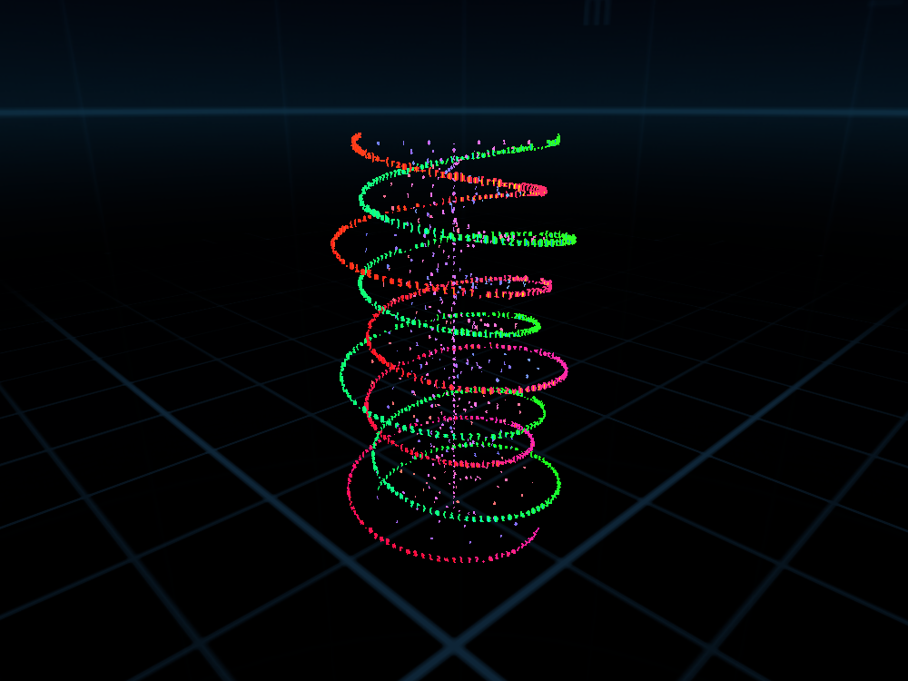
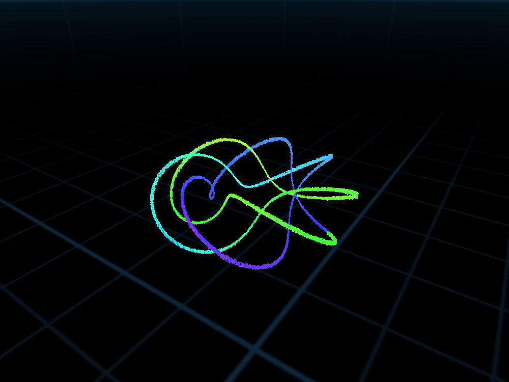
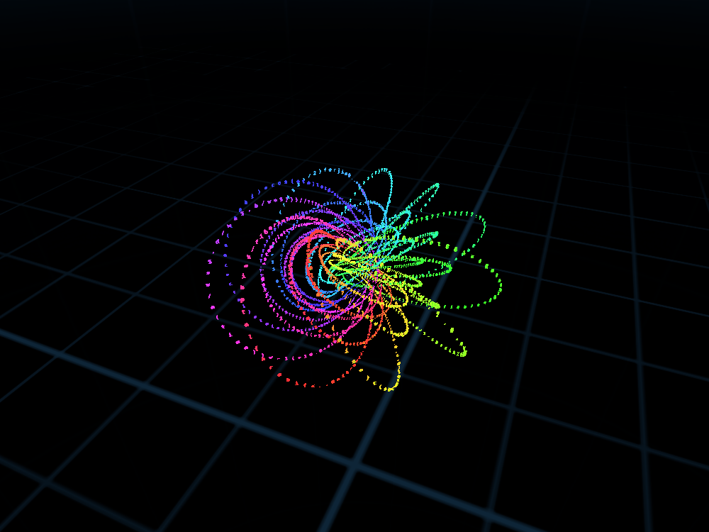
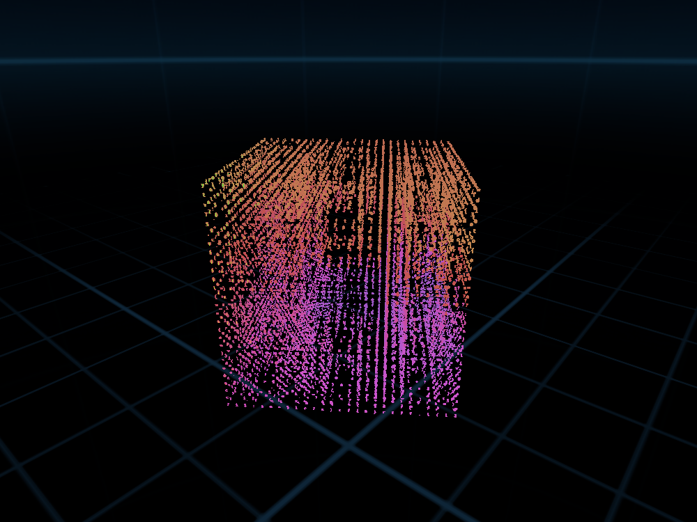
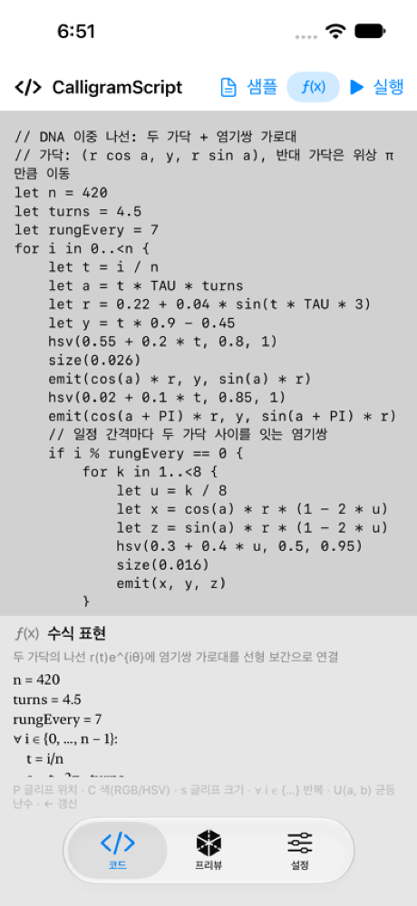
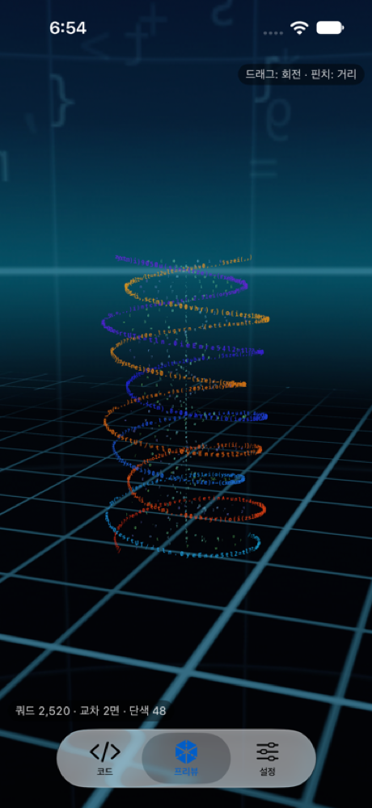
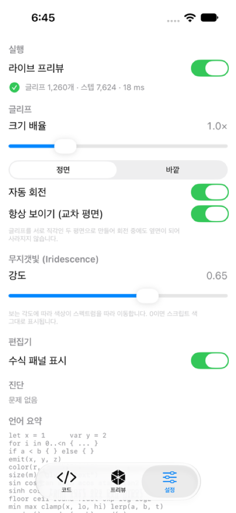

<div align="center">

# Immersive Code Calligram IDE

**코드의 글자로 그리는 3D 캘리그램**

작은 스크립트로 도형을 정의하면, 그 소스 코드의 글자 하나하나가 순서대로 배치되어
3차원 형상의 표면과 궤적을 이룹니다. 코드를 고치면 0.5초 안에 도형이 다시 그려집니다.

[](#플랫폼별-경험)
[](#)
[](#)
[](LICENSE)
[%20·%20ios%20(iPhone%20%2F%20iPad)-34C759)](#브랜치)

<br/>



<br/>



<sub>DNA 이중 나선 · (3,7) 토러스 매듭 · 호프 올뭉치 · 멩거 스펀지 — 모두 앱 안의 29개 샘플 중 하나를 그대로 렌더링한 결과입니다.</sub>

</div>

---

## 목차

- [이게 뭔가요](#이게-뭔가요)
- [주요 기능](#주요-기능)
- [플랫폼별 경험](#플랫폼별-경험)
- [iPhone · iPad](#iphone--ipad)
- [CalligramScript 맛보기](#calligramscript-맛보기)
- [내장 샘플 29종](#내장-샘플-29종)
- [브랜치](#브랜치)
- [시작하기](#시작하기)
- [프로젝트 구조](#프로젝트-구조)
- [라이선스](#라이선스)

## 이게 뭔가요

캘리그램(calligram)은 글자로 그림을 그리는 기법입니다. 이 앱에서는 **사용자가 쓴 소스 코드의 글자 자체**가 재료가 됩니다.

1. 코드 에디터에 기하/알고리즘 스크립트를 입력합니다.
2. 앱이 코드를 파싱·실행해 점(point)들을 만듭니다.
3. 각 점에는 소스 코드에서 공백을 뺀 글자가 `emit()` 호출 순서대로 하나씩 붙습니다.
4. 결과물은 "글자로 그려진 도형"이 되어 Vision Pro의 몰입 공간, iPhone의 AR 카메라, 또는 Mac 창 안에 나타납니다.

용도는 열어 두었습니다. 수학 시각화, 코드 아트, 교육용 데모 어디에든 쓸 수 있는 **"코드 → 즉시 3D 프리뷰" 루프**를 견고하게 만드는 데 집중한 프로젝트입니다.

## 주요 기능

| | 기능 | 설명 |
|:-:|---|---|
| ✍️ | **CalligramScript** | Swift 문법에 가까운 소형 DSL. `let/var`, `for i in a..<b`, `if/else`, 30여 개의 수학 함수(`sin cos sinh sqrt fract atan2 clamp lerp random …`)와 씬 함수(`emit color hsv size glyph`). 실제 Swift를 컴파일하는 게 아니라 자체 트리 워킹 인터프리터가 안전하게(스텝·emit 한도 포함) 실행합니다. |
| 📐 | **코드 → 수식 자동 변환** | 편집기 아래 패널이 현재 코드를 `∀ i ∈ {0, …, n−1}`, `√`, `π`, `HSV(…)` 같은 수학 표기로 다시 써 줍니다. 수식만 보고도 알고리즘의 구조를 읽을 수 있습니다. |
| 🧩 | **샘플 29종 · 7개 카테고리** | 곡선·매듭, 곡면, 끌개·카오스, 프랙탈·IFS, 격자·필드, 4차원·위상, 타이포그래피. 메뉴에서 고르면 코드·수식·도형이 동시에 바뀝니다. |
| 👁️ | **항상 보이는 글리프** | 글리프를 서로 직각인 두 평면으로 만들어, 도형이 회전하다 옆면이 되어 사라지는 일이 없습니다. |
| 🌈 | **Iridescent 머티리얼** | MaterialX 셰이더 그래프가 시선 각도에 따라 색상을 스펙트럼을 따라 이동시킵니다. 강도 0이면 스크립트가 지정한 색 그대로. |
| ⚡ | **라이브 프리뷰** | 입력 후 450 ms 디바운스 → 백그라운드 실행 → 메시 교체. 오류가 나면 줄·열 번호를 보여 주고 마지막으로 성공한 도형은 그대로 둡니다. |
| 📱 | **AR 배치 모드 (iPhone · iPad)** | 후면 카메라로 바닥·책상 같은 평면을 찾아 그 위에 캘리그램을 올립니다. 드래그로 회전, 핀치로 크기 조절. |

## 플랫폼별 경험

| 플랫폼 | 어떻게 보이나요 | 조작 |
|---|---|---|
| **Apple Vision Pro** | "이머시브 공간 진입" 버튼으로 반경 40 m SkyDome 안에 들어가면 눈앞 1.6 m, 높이 1.4 m에 실물 크기 도형이 떠 있습니다. 창은 그대로 남아 계속 편집할 수 있습니다. | 머리 회전으로 둘러보기, 자동 회전 |
| **iPhone · iPad (AR)** | 카메라 영상 위, 실제 책상이나 바닥 45 cm 위에 도형이 놓입니다. 평면을 아직 못 찾았으면 상단 배너가 안내합니다. | 드래그: 회전 · 핀치: 크기 · "다시 배치" |
| **iPhone · iPad (프리뷰)** | 가상 카메라가 비추는 창 안 캔버스. 시뮬레이터에서도 동작합니다. | 드래그: 궤도 회전 · 핀치: 거리 |
| **Mac** | 같은 프리뷰 캔버스를 3열 레이아웃(에디터 · 프리뷰 · 설정)으로. Vision Pro 없이 개발하기 위한 모드입니다. | 드래그 · 트랙패드 핀치 |

## iPhone · iPad

`ios` 브랜치는 iPhone과 iPad에 맞춘 레이아웃과 AR 배치 모드를 담고 있습니다.

<div align="center">



<br/>
<sub>iPhone 16 시뮬레이터(iOS 27) · 코드 탭(에디터 + 수식 패널) / 프리뷰 탭 / 설정 탭</sub>
</div>

- **iPhone**: `코드` · `프리뷰` · `AR` · `설정` 네 개의 탭. `AR` 탭은 ARKit 월드 트래킹이 되는 실기기에서만 나타나며, 시뮬레이터에는 카메라가 없으므로 자동으로 숨겨집니다.
- **iPad (가로)**: Mac과 같은 3열 레이아웃에, 프리뷰 영역 상단의 **가상 카메라 ↔ AR** 세그먼트로 모드를 전환합니다.
- **AR 모드**: `RealityView`의 `spatialTracking` 카메라와 `SpatialTrackingSession`으로 수평 평면을 찾고, 그 위에 도형을 앵커링합니다. 스카이돔과 바닥 격자는 끄고 실제 공간을 배경으로 씁니다. 카메라 권한이 꺼져 있으면 설정으로 안내합니다.
- **편집 편의**: 좁은 폭에 맞춘 수식 패널, 키보드 위 `완료` 버튼으로 바로 닫기.

## CalligramScript 맛보기

```swift
// 이중 나선: 두 가닥 + 염기쌍 가로대
let n = 420
let turns = 4.5
for i in 0..<n {
    let t = i / n
    let a = t * TAU * turns
    let r = 0.22 + 0.04 * sin(t * TAU * 3)
    let y = t * 0.9 - 0.45
    hsv(0.55 + 0.2 * t, 0.8, 1)
    size(0.026)
    emit(cos(a) * r, y, sin(a) * r)
    hsv(0.02 + 0.1 * t, 0.85, 1)
    emit(cos(a + PI) * r, y, sin(a + PI) * r)
}
```

같은 코드가 수식 패널에서는 이렇게 보입니다.

```
∀ i ∈ {0, …, n − 1}:
    t = i/n
    a = t · 2π · turns
    r = 0.22 + 0.04 sin(t · 2π · 3)
    y = t · 0.9 − 0.45
    C ← HSV(0.55 + 0.2t, 0.8, 1)
    s ← 0.026
    P ← (cos(a) · r, y, sin(a) · r)
```

<details>
<summary><b>언어 요약 펼치기</b></summary>

| 구분 | 내용 |
|---|---|
| 선언·대입 | `let x = 1` `var y = 2` `y += 1` (`= += -= *= /=`) |
| 반복 | `for i in 0..<n { … }` `for i in a...b { … }` |
| 조건 | `if a < b { … } else if … { … } else { … }` |
| 연산자 | `+ - * / % ^`(거듭제곱, 우결합) `== != < <= > >=` `&& \|\| !` |
| 씬 함수 | `emit(x, y, z)` `color(r, g, b[, a])` `hsv(h, s, v)` `size(m)` `glyph("text")` |
| 수학 함수 | `sin cos tan asin acos atan atan2 sinh cosh tanh sqrt abs pow hypot floor ceil round fract exp log log2 sign min max clamp lerp random seed` |
| 상수 | `PI` `TAU` `E` |
| 안전 한도 | emit 15,000개 · 실행 스텝 1,500,000 (초과 시 줄·열과 함께 오류, 부분 결과 유지) |

</details>

## 내장 샘플 29종

| 카테고리 | 샘플 |
|---|---|
| 곡선 · 매듭 | DNA 이중 나선 · 토러스 매듭 (3,7) · 세잎 매듭 튜브 (프레네 틀) · 리사주 매듭 (3,4,7) · 마우러 장미 (6, 71°) · 심장 곡선 입체 |
| 곡면 | 뫼비우스 띠 · 클라인 병 (8자형) · 구면 조화 함수 곡면 · 슈퍼포뮬러 3D · 디니 곡면 · 브리더 곡면 · 엔네퍼 극소곡면 · 소라 껍데기 |
| 끌개 · 카오스 | 로렌츠 · 아이자와 · 토마스 순환대칭 · 클리퍼드 |
| 프랙탈 · IFS | 줄리아 집합 높이맵 · 멩거 스펀지 (3단계) · 시에르핀스키 사면체 (카오스 게임) · 반슬리 고사리 |
| 격자 · 필드 | 간섭 파동 격자 · 피보나치 구 · 잎차례 돔 (황금각) · 나선 은하 |
| 4차원 · 위상 | 호프 올뭉치 (S³ → S²) · 클리퍼드 토러스 (4D 회전) |
| 타이포그래피 | 글리프 실린더 (텍스트 링) |

각 샘플에는 수학적 요약이 붙어 있어 수식 패널 상단에 함께 표시됩니다.

## 브랜치

| 브랜치 | 대상 | 설명 |
|---|---|---|
| `main` | Apple Vision Pro | 몰입 공간 버전. 기준 브랜치이며 visionOS 코드는 여기서만 관리합니다. |
| `ios` | iPhone · iPad | 탭 레이아웃, iPad 3열 레이아웃, 실기기 전용 AR 배치 모드. 시뮬레이터(iPhone 16)에서 테스트합니다. |

## 시작하기

**요구 사항**: visionOS 27 / iOS 27 / macOS 27 SDK가 포함된 Xcode. AR 모드는 ARKit 월드 트래킹을 지원하는 실제 iPhone/iPad가 필요합니다.

```bash
git clone https://github.com/kimminung/Immersive-Code-Calligram-IDE.git
cd Immersive-Code-Calligram-IDE
git switch ios        # iPhone/iPad 버전 (Vision Pro는 main)
open "Immersive Code Calligram IDE.xcodeproj"
```

1. 실행 대상을 고릅니다.
   - **iPhone 16 시뮬레이터** — 탭 레이아웃과 가상 카메라 프리뷰 확인 (AR 탭 없음).
   - **실제 iPhone / iPad** — `AR` 탭에서 카메라로 평면을 찾아 배치.
   - **My Mac** — 별도 기기 없이 3열 레이아웃으로 바로 확인.
   - **Apple Vision Pro** — `main` 브랜치에서 "이머시브 공간 진입".
2. `Cmd + R`로 빌드·실행합니다.
3. 에디터 상단 **샘플** 메뉴에서 도형을 고르고, 코드를 바꿔 보세요. 수식 패널이 함께 바뀝니다.

## 프로젝트 구조

```
Immersive Code Calligram IDE/
├─ MyApp.swift, ContentView.swift          # 창 · 몰입 공간 · 플랫폼별 레이아웃 분기
├─ Model/
│   ├─ AppModel.swift                      # @Observable 상태, 디바운스 실행
│   ├─ CalligramRenderSettings.swift       # 글리프 크기·방향·교차 평면·무지갯빛 강도
│   └─ ARSupport.swift                     # AR 가능 여부 (실기기 + ARKit만 true)
├─ Language/
│   ├─ CalligramLexer / AST / Parser / Interpreter / Engine
│   ├─ CalligramMathFormatter.swift        # 코드 → 수학 표기
│   └─ CalligramSamples.swift              # 샘플 29종
├─ Rendering/
│   ├─ GlyphAtlas.swift                    # CoreText 글리프 아틀라스
│   ├─ CalligramMeshBuilder.swift          # 점 → 교차 쿼드 메시, 팔레트 양자화
│   ├─ IridescentGlyphMaterial.swift       # MaterialX 셰이더 그래프 (USDA)
│   ├─ EnvironmentTextureRenderer.swift    # 스카이돔 · 바닥 격자 텍스처
│   ├─ SpinSystem.swift                    # 자동 회전 ECS 시스템
│   └─ CalligramSceneController.swift      # 씬 구성 (immersive / preview / ar)
└─ Views/
    ├─ CodeEditorView.swift                # 에디터 + 샘플 메뉴 + 수식 패널
    ├─ ControlPanelView.swift              # 실행 · 글리프 · 무지갯빛 · 진단
    ├─ PreviewCanvasView.swift             # 가상 카메라 프리뷰 (Mac · iOS)
    ├─ ARCalligramView.swift               # AR 배치 모드 (iOS 실기기)
    ├─ ImmersiveCalligramView.swift        # 몰입 공간 (visionOS)
    └─ ImmersiveToggleButton.swift
Docs/                                      # PRD, 작업 목록
Media/Screenshots/                         # README 이미지
```

아키텍처와 데이터 흐름은 [`Docs/PRD-CodeCalligram.md`](Docs/PRD-CodeCalligram.md)에 정리되어 있습니다.

## 라이선스

[Apache License 2.0](LICENSE)
